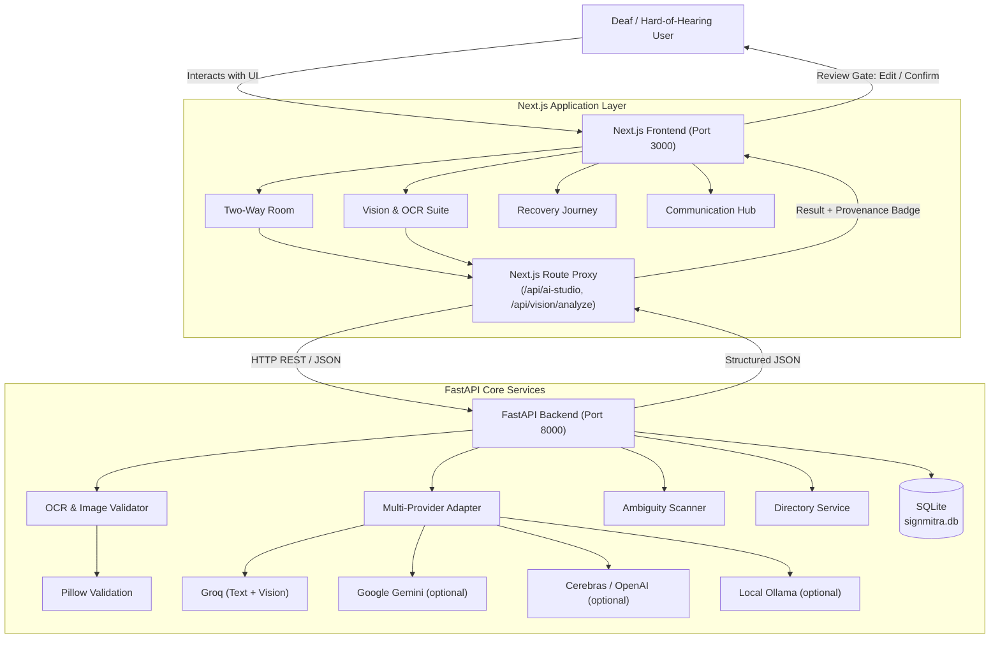

# SignMitra

> **An accessible counter-communication companion for Indian Sign Language (ISL) users.**
> Visual cards, human-in-the-loop AI assistance, and verified accessibility information for public counters: colleges, banks, hospitals, and transit hubs.

**Status:** working prototype · **Stack:** Next.js + FastAPI · **Works offline:** core phrasebook, simplification, and fallbacks

---

## Table of Contents

- [Overview](#overview)
- [Scope and Limitations](#scope-and-limitations)
- [Key Features](#key-features)
- [Design Principles](#design-principles)
- [Demo and Screenshots](#demo-and-screenshots)
- [Technology Stack](#technology-stack)
- [Architecture](#architecture)
- [Prerequisites](#prerequisites)
- [Getting Started](#getting-started)
- [Environment Variables](#environment-variables)
- [Running the Application](#running-the-application)
- [API Documentation](#api-documentation)
- [Testing](#testing)
- [AI, Vision, and Provider Behavior](#ai-vision-and-provider-behavior)
- [Privacy, Safety, and Ethical Boundaries](#privacy-safety-and-ethical-boundaries)
- [Troubleshooting](#troubleshooting)
- [Roadmap](#roadmap)
- [Contributing](#contributing)
- [License](#license)
- [Acknowledgements](#acknowledgements)

---

## Overview

### The Problem

Deaf and Hard-of-Hearing people who use Indian Sign Language routinely face barriers at administrative counters (university registrars, bank windows, hospital OPDs, railway ticket counters) where staff do not understand ISL. Typical failures:

- Communication breakdowns and long delays.
- Vague verbal instructions such as *"Come back tomorrow morning with the prescribed form"*, with no form name, counter, or time.
- Misunderstood deadlines, fees, and required documents.
- Dependence on ad-hoc paper notes or interpreters who are not always available.

### The Solution

SignMitra turns a one-sided verbal exchange into a structured, visual, two-way interaction. It helps the user **prepare** before a visit, **communicate** at the desk, **catch vague replies** before leaving, and **follow up** afterwards.

It combines three layers:

1. **Deterministic, offline-first foundations.** A curated phrasebook, rule-based text simplification, Pillow-based image validation, and local session storage that work without any API key.
2. **Human-in-the-loop AI.** Optional LLM providers rewrite drafts, translate into regional languages, extract text from documents, and flag ambiguous staff replies. Nothing is shown to staff until the user approves it.
3. **Provenance transparency.** Every output is labeled by origin: *Live Model Generated*, *Curated Institutional Phrasebook*, *Deterministic Validation*, or *User Entered*.

---

## Scope and Limitations

- **A communication companion, not an interpreter.** SignMitra is not a certified sign language interpreter, translation authority, or legal representative.
- **ISL recognition is not yet available.** The ISL Lab provides a reference catalog and practice mirror only. Automated gesture recognition needs trained model weights that are not included (see [Roadmap](#roadmap)). The app never fabricates predictions.
- **Not an emergency service.** The Emergency Card is a display aid; it does not contact 112 or guarantee any response.
- **Review is mandatory.** Rewrites, translations, and OCR results must be reviewed or edited by the user before use.
- **Text-based by design.** Many ISL users have limited written-language literacy. The app therefore leans on short, high-contrast cards, simplification, and icons. User testing with the Deaf community is still needed (see [Roadmap](#roadmap)).

---

## Key Features

### 1. Two-Way Communication Room
*Routes: `/ai-studio` (Two-Way Room), `/conversation`*

- **Tone-adjusted rewriting** of short notes into counter-ready phrasing: **Polite**, **Clear**, **Simpler**, **Urgent**.
- **Regional translation** into Hindi, Tamil, Marathi, Bengali, Telugu, and Kannada.
- **Approval gate.** Side-by-side view of the original and transformed text; the user edits, then clicks **Approve & Display Card** or discards.
- **Live speech subtitles** of staff replies via the browser's Web Speech API, labeled `Browser Web Speech API · Live Speech Subtitle` (`is_ai: false`), with text-to-speech playback.

### 2. Multimodal Vision & Document OCR
*Route: `/ai-studio` (Vision & OCR)*

Four workflows:

| Workflow | What it does |
| :--- | :--- |
| **Queue & Token Reader** | Token numbers, counter, department, dates, times, queue instructions |
| **Text Reader (OCR)** | Visible printed text in an editable, copyable review area |
| **Notice & Documents** | Document type, numbers, dates, items, quantities, amounts, payment details, instructions |
| **Image Description** | Objective, privacy-safe description (no face recognition, no attribute inference) |

- **Input:** drag-and-drop, file browse, or webcam snapshot.
- **Pillow validation before inference:** format (PNG, JPEG, WebP), size (≤ 5 MB), readability, minimum dimensions.
- **Generic documents:** receipts, bills, notices, tickets, forms, and application documents, based only on what is visible.
- **No fabrication:** unreadable or missing values are reported as unavailable. Edits reset the confirmation state until the user re-approves.
- **Graceful failure:** on quota exhaustion the image and notes are preserved and no text is invented (see [Provider Failure Handling](#provider-failure-handling)).

### 3. Indian Language Tools & Simplification
*Routes: `/ai-studio` (Language Tools), `/phrasebook`*

- **Offline curated phrasebook** for emergency, medical, banking, and transit phrases. No internet or API key needed.
- **Rule-based simplification** of institutional wording (e.g., *mandatory → required*, *prior to → before*, *commencing → starting*).
- **Script-based language detection** for Devanagari, Tamil, Bengali, Telugu, Kannada, and Latin.

### 4. Interaction Copilot & Ambiguity Detection
*Routes: `/ai-studio` (Recovery Journey), `/journey/[id]`*

- **Visit preparation checklists** (e.g., student ID, self-attested Aadhaar, fee receipts) and opening phrase cards.
- **Staff reply ambiguity scanner** that flags vague deadlines (*"come tomorrow morning"*), unspecified fees (*"nominal charges"*), and missing counter or form names.
- **Clarification question cards**, e.g., *"Which counter should I submit this form to?"*
- **Outcome summarizer** that separates **Verified Facts** from **Unresolved Questions** and saves follow-ups to the planner.

### 5. Practice Rehearsal Simulator
*Route: `/ai-studio` (Rehearsal)*

- Simulated counter conversations for College Office, Bank, Hospital OPD, and Transit Desk with different staff demeanors.
- Evaluation on a 3-criteria rubric (Clarity of Request; Polite Assertiveness & Accommodations; Practical Readiness / Document Awareness) with a 0–100 readiness score and feedback.
- **Deterministic rubric fallback** when AI providers are offline or rate-limited.

### 6. Verified Accessibility Directory
*Routes: `/directory`, `/ai-studio` (Directory & Evidence)*

- Searchable records of banks, colleges, hospitals, and transit terminals, covering sign-language-trained staff, visual display boards, writing pads, quiet rooms, and wheelchair access.
- **Evidence-grounded disclosure:** attributes absent from audit records are shown as *Not Reported*, never assumed.
- **Community feedback** reporting for actual conditions at counters.

### 7. ISL Lab (Reference and Practice Only)
*Route: `/ai-studio` (ISL Lab), API: `/api/isl`*

- **ISLRTC functional sign reference catalog** (emergency, healthcare, administrative) with handshape, movement, and one- or two-handed execution.
- **Webcam practice mirror** (client-side) for comparing your signing with reference descriptions.
- **Honest pipeline status:** recognition requires `backend/model_weights/isl_classifier.onnx`. Without it, `/api/isl/recognize` reports the missing checkpoint and returns no prediction.

### 8. Domain Action Suites
*Routes: `/banking`, `/healthcare`, `/education`, `/transport`, `/emergency-card`*

- **Banking:** KYC submission, passbook update, deposit confirmation.
- **Healthcare:** symptom onset, OPD registration, visual alerts in waiting rooms.
- **Education:** hall ticket verification, fee receipts, scholarship queries.
- **Transport:** platform inquiries, ticket purchase, conductor notification requests.
- **Emergency Card:** full-screen high-contrast medical profile, blood group, emergency contacts, and a QR code.

Also included: **Queue Companion** (`/queue-companion`), **Staff Response** (`/staff-response`), **Follow-ups planner** (`/followups`), and **History** (`/history`).

---

## Design Principles

1. **Never fabricate.** No guessed OCR text, no fake ISL predictions, no assumed directory facts.
2. **The user stays in control.** Every AI output passes through an edit-and-approve gate.
3. **Label everything.** Provenance badges make clear what is AI-generated and what is not.
4. **Degrade gracefully.** Offline phrasebook, rule-based simplification, and rubric fallbacks keep the app useful when connectivity or quotas fail.
5. **Accessible by default.** A 3-color high-contrast palette (Linen `#FDF1E2`, Amethyst `#AB92BF`, Dolphin `#655A7C`) with dark mode.

---

## Demo and Screenshots

> Add assets to `public/screenshots/` and link them here.

Recommended captures:

1. Two-Way Room: draft rewrite with the review and approval gate
2. Queue/token slip extraction
3. OCR output in the editable verification area
4. Structured document extraction (bill, receipt, notice)
5. Privacy-safe image description
6. Ambiguity scanner flagging *"tomorrow morning"* with a clarification card
7. Verified directory records with *Not Reported* tags

**Demo video:** _add link_ · **Live deployment:** _add link_

Suggested demo flow (about 2 minutes): hospital OPD → staff says *"come tomorrow morning"* → scanner flags the ambiguity → clarification card shown → verified facts saved to the planner.

---

## Technology Stack

| Layer | Technology | Version | Purpose |
| :--- | :--- | :--- | :--- |
| Frontend | [Next.js](https://nextjs.org/) (App Router) | `16.3.6` | Rendering, routing (33 routes), API proxy handlers |
| UI | [React](https://react.dev/) | `19.2.8` | Component state and interaction flows |
| Styling | [Tailwind CSS](https://tailwindcss.com/) | `^4.0` | Accessible palette, responsive layout, dark mode |
| Icons | [Lucide React](https://lucide.dev/) | `^1.48.0` | Status and navigation iconography |
| Backend | [FastAPI](https://fastapi.tiangolo.com/) | `^0.110.0` | Async REST API, OpenAPI docs |
| ASGI server | [Uvicorn](https://www.uvicorn.org/) | `^0.28.0` | Serves the backend on `127.0.0.1:8000` |
| Database | [SQLAlchemy](https://www.sqlalchemy.org/) + SQLite | `^2.0.0` | Sessions, directory records, tasks |
| Validation | [Pydantic](https://docs.pydantic.dev/) + Settings | `^2.6.0` | Schemas and env configuration |
| Images | [Pillow](https://python-pillow.org/) | `^10.2.0` | Format, size, and dimension validation |
| AI adapter | Custom multi-provider adapter | — | Routes text and vision calls without coupling features to one SDK |
| Vision (verified) | Groq Vision | configured | Current tested vision configuration |
| Text AI | Groq (default); Cerebras, OpenAI, Gemini, Ollama supported | configured | Rewrite, translation, rehearsal |
| Gemini SDK | [Google GenAI SDK](https://github.com/google-gemini/generative-ai-python) | `^0.1.1` | Optional Gemini provider |
| HTTP client | [HTTPX](https://www.python-httpx.org/) | `^0.27.0` | Async provider calls |
| QR codes | qrcode.react | `^4.2.0` | Offline emergency-contact QR |
| Browser APIs | Web Speech API, MediaDevices | native | Speech recognition, TTS, camera |

---

## Architecture

### Request Flow



### Vision Processing Flow

```text
User Image
  → Next.js VisionSuite
  → Next.js /api/ai-studio proxy
  → FastAPI /api/ai-studio
  → Vision / OCR service
  → Pillow validation + decoding
  → Centralized AI provider adapter
  → Configured vision model
  → Structured JSON result
  → VisionSuite: human review / confirmation
```

### Directory Tree

```text
signmitra/
├── app/                              # Next.js App Router
│   ├── ai-studio/                    # Flagship AI Studio (TwoWayRoom, VisionSuite, LanguageSuite, ...)
│   │   └── utils/                    # speech-helpers.js (Web Speech API)
│   ├── api/                          # Next.js route handlers
│   │   ├── ai-assist/                # Legacy AI assist endpoint
│   │   ├── ai-studio/                # Dispatcher + local fallback engine (+ health/)
│   │   └── vision/analyze/           # Vision proxy to FastAPI
│   ├── communication-hub/            # Domain selection hub
│   ├── conversation/                 # Two-way visual conversation
│   ├── directory/                    # Accessibility directory
│   ├── emergency-card/               # High-contrast emergency card
│   ├── followups/                    # Follow-up planner
│   ├── history/                      # Session logs
│   ├── journey/[id]/                 # Guided counter journeys
│   ├── phrasebook/                   # Offline phrasebook
│   ├── queue-companion/              # Token tracking and visual alerts
│   ├── staff-response/               # Staff visual response screen
│   ├── steps/                        # Journey steps overview
│   ├── layout.js                     # Root layout, fonts, PWA registration
│   └── page.js                       # Landing page
├── backend/                          # FastAPI backend
│   ├── config.py · database.py · main.py
│   ├── models/                       # directory, followup, history, session
│   ├── routers/                      # communication, directory, health, isl, language,
│   │                                 # recovery, rehearsal, sessions, settings, vision
│   ├── schemas/                      # Pydantic schemas
│   ├── services/                     # ai_provider, ai_service, ambiguity_service,
│   │                                 # directory_service, isl_service, ocr_service,
│   │                                 # rehearsal_service, translation_service
│   ├── tests/                        # Pytest suite (12 modules)
│   └── requirements.txt
├── components/                       # Shared React components (Navbar, api.js, PWARegister)
├── context/                          # ThemeContext
├── public/                           # Icons, manifest.json, sw.js
├── server/                           # Optional Express/MongoDB service (not needed for core flows)
├── tests/                            # Node integration tests + Playwright e2e
├── .env.example
├── DEVELOPMENT_GUIDE.md
└── README.md
```

---

## Prerequisites

| Requirement | Version | Purpose |
| :--- | :--- | :--- |
| Node.js | 20.x or 22.x (LTS) | Frontend and test harness |
| npm | 10.x+ | Package manager |
| Python | 3.11 – 3.14 | FastAPI backend |
| AI provider key *(optional)* | Groq, Gemini, Cerebras, or OpenAI | Live rewriting, translation, vision. Offline fallbacks work without keys. |
| MongoDB *(optional)* | 6.0+ | Only for the optional Express service in `server/` |

---

## Getting Started

### Windows (PowerShell)

```powershell
# 1. Clone
git clone https://github.com/RimshaComix/signmitra.git
cd signmitra

# 2. Environment file (read by both Next.js and FastAPI)
Copy-Item .env.example .env

# 3. Frontend dependencies
npm install

# 4. Backend virtual environment and dependencies
python -m venv backend\.venv
.\backend\.venv\Scripts\Activate.ps1
pip install -r backend\requirements.txt
```

**Terminal 1: backend (run from the repository root)**

```powershell
.\backend\.venv\Scripts\Activate.ps1
python -m uvicorn backend.main:app --reload --host 127.0.0.1 --port 8000
```

**Terminal 2: frontend (also from the repository root)**

```powershell
npm run dev
```

### macOS / Linux (Bash)

```bash
git clone https://github.com/RimshaComix/signmitra.git
cd signmitra
cp .env.example .env
npm install

python3 -m venv backend/.venv
source backend/.venv/bin/activate
pip install -r backend/requirements.txt

# Terminal 1 (repo root)
python -m uvicorn backend.main:app --reload --host 127.0.0.1 --port 8000

# Terminal 2 (repo root)
npm run dev
```

### Local URLs

| Service | URL |
| :--- | :--- |
| Frontend | http://localhost:3000 |
| AI Studio | http://localhost:3000/ai-studio |
| Backend | http://127.0.0.1:8000 |
| Swagger UI | http://127.0.0.1:8000/docs |
| Health check | http://127.0.0.1:8000/api/health |

---

## Environment Variables

Provider keys are **server-side only**. Never commit `.env` files containing real credentials.

| Variable | Purpose | Default | Notes |
| :--- | :--- | :--- | :--- |
| `AI_PROVIDER` | Active text provider: `groq`, `gemini`, `cerebras`, `openai`, `ollama` | auto-detected | Chosen from available keys if omitted |
| `AI_MODEL` | Override the provider's default model | provider default | e.g., `llama-3.3-70b-versatile` |
| `GROQ_API_KEY` | Groq key (text and vision) | none | [console.groq.com](https://console.groq.com) |
| `GEMINI_API_KEY` | Gemini key (optional provider) | none | [aistudio.google.com](https://aistudio.google.com) |
| `CEREBRAS_API_KEY` | Cerebras key | none | [cloud.cerebras.ai](https://cloud.cerebras.ai) |
| `OPENAI_API_KEY` | OpenAI key | none | [platform.openai.com](https://platform.openai.com) |
| `OLLAMA_BASE_URL` | Local Ollama endpoint | `http://localhost:11434` | Fully local inference, [ollama.com](https://ollama.com) |
| `AI_BACKEND_URL` | Backend URL used by Next.js server routes | `http://127.0.0.1:8000` | |
| `NEXT_PUBLIC_AI_BACKEND_URL` | Backend URL used by browser code | `http://127.0.0.1:8000` | |
| `DATABASE_URL` | SQLAlchemy connection string | `sqlite:///backend/data/signmitra.db` | Auto-created on first start |
| `REQUEST_TIMEOUT_SECONDS` | Timeout for provider calls | `30` | |
| `NEXT_PUBLIC_API_BASE_URL` | Optional Express service base URL | `http://localhost:5000/api` | Only for `server/` |
| `MONGODB_URI` | Optional Express MongoDB URI | `mongodb://127.0.0.1:27017/signmitra` | Only for `server/` |

---

## Running the Application

Both processes must run together:

1. **FastAPI backend** (`127.0.0.1:8000`): AI provider delegation, OCR, SQLite storage, directory queries.
2. **Next.js frontend** (`localhost:3000`): UI, speech recognition, and proxying to the backend.
3. **Express service** (`localhost:5000`, *optional*): a secondary state-machine session service in `server/` backed by MongoDB. Not required for any AI Studio workflow.

---

## API Documentation

Interactive docs are served by the running backend at **`/docs`** (Swagger) and **`/redoc`**.

| Prefix | Method | Endpoint | Description |
| :--- | :--- | :--- | :--- |
| `/api` | GET | `/health` | Health, database, and active provider status |
| `/api` | GET | `/status` | Service, environment, and ISL pipeline status |
| `/api` | POST | `/ai-studio` | Unified dispatcher connecting Next.js to FastAPI services |
| `/api/communication` | POST | `/card` | Compose a communication card from intent |
| `/api/communication` | POST | `/rewrite` | Rewrite a draft (Polite, Clear, Simpler, Urgent) |
| `/api/communication` | POST | `/translate` | Translate a draft with review gate |
| `/api/vision` | POST | `/analyze` | Pillow validation + vision/OCR analysis |
| `/api/language` | POST | `/translate` | Translate to regional languages |
| `/api/language` | POST | `/simplify` | Rule-based simplification |
| `/api/recovery` | POST | `/prepare` | Visit checklist, required documents, cards |
| `/api/recovery` | POST | `/extract` | Scan staff replies for ambiguity |
| `/api/recovery` | POST | `/summarize` | Verified facts vs. unresolved questions |
| `/api/rehearsal` | POST | `/scenario` | Generate a practice scenario |
| `/api/rehearsal` | POST | `/evaluate` | Score a practice response on the rubric |
| `/api/directory` | GET | `/` | Search records (query, city, domain) |
| `/api/directory` | POST | `/` | Create an audit record |
| `/api/directory` | GET / PUT / DELETE | `/{record_id}` | Read, update, delete a record |
| `/api/sessions` | GET / POST | `/` | List or persist sessions |
| `/api/sessions` | GET / PUT / DELETE | `/{session_id}` | Read, update, delete a session |
| `/api/sessions` | GET / POST | `/planner/tasks` | Read or save follow-up tasks |
| `/api/settings` | GET / POST | `/` | Accessibility and privacy preferences |
| `/api/isl` | GET | `/status` | True status of the ISL recognition pipeline |
| `/api/isl` | GET | `/catalog` | ISLRTC reference sign catalog |
| `/api/isl` | POST | `/recognize` | Recognition contract (reports missing checkpoint when no weights) |

---

## Testing

### Backend (Pytest)

```bash
# macOS / Linux
source backend/.venv/bin/activate
python -m pytest backend/tests --ignore=backend/tests/test_vision_429.py -v
```

```powershell
# Windows
.\backend\.venv\Scripts\Activate.ps1
python -m pytest backend/tests --ignore=backend/tests/test_vision_429.py -v
```

Runs **28 passing tests** across 11 modules: `test_ai_service`, `test_ambiguity`, `test_communication`, `test_directory`, `test_health`, `test_isl`, `test_language`, `test_recovery`, `test_rehearsal`, `test_sessions`, `test_vision`.

> **Known gap:** `test_vision_429.py` (the 12th module) is excluded because it imports an exception symbol, `AIProviderQuotaExhaustedError`, that `ai_provider.py` does not yet export. It can be re-enabled once the symbol is exported.

### Frontend integration tests (Node)

```bash
node tests/api-studio.test.mjs
node tests/language-tools.test.mjs
node tests/twoway-typed-workflow.test.mjs
node tests/twoway-translation.test.mjs
node tests/twoway-speech.test.mjs
node tests/journey-audit.test.mjs
node tests/phase3-tools.test.mjs
```

Covers 58+ assertions on prompt boundaries, speech fallbacks, provenance tracking, and the offline phrasebook. The vision route tests (`vision-ocr.test.mjs`, `vision-429.test.mjs`) exercise the Next.js route handler and are validated through `npm run build` and runtime checks.

### Build and end-to-end

```bash
npm run build                                          # compiles all 33 routes
npx playwright test tests/e2e/signmitra-journey.spec.js   # optional e2e
```

### Evaluation metrics

> _Not yet published._ Planned: OCR extraction accuracy on a labeled sample of counter documents, ambiguity-scanner precision/recall on staff-reply samples, and end-to-end latency. See [Roadmap](#roadmap).

---

## AI, Vision, and Provider Behavior

### Provider Routing

A centralized adapter keeps features independent of any single AI SDK. The active provider is chosen from configuration and available credentials.

| Provider | Role |
| :--- | :--- |
| **Groq** | Current verified provider for text and vision |
| **Google Gemini** | Supported where configured (text and vision) |
| **Cerebras** | Supported text provider |
| **OpenAI** | Supported provider |
| **Ollama** | Optional local, private inference (`AI_PROVIDER=ollama`) |

Provider changes require no change to the VisionSuite frontend.

### Verified Vision Workflows

Verified against hospital bills, restaurant bills and receipts, notices, queue/token slips, forms, and application documents. Output reflects only what is visible in the uploaded image.

### Provider Failure Handling

When a provider returns a rate-limit or quota error (e.g., HTTP 429 `RESOURCE_EXHAUSTED`):

1. The backend parses retry information.
2. If the suggested delay is short (≤ 2.0 s), it performs **at most one** bounded retry.
3. If a daily quota is exhausted or the delay is longer, it stops immediately, with no retry loops.
4. It returns an explicit failure state:
   - `extracted_text: ""`, with nothing invented
   - `is_interpreted_by_ai: false`, `live_inference_blocked: true`
   - an `engine` value identifying the exhausted provider (e.g., `gemini_vision_quota_exhausted`)
5. The UI shows an advisory banner and keeps the uploaded image and user notes.

Free-tier quotas can be small (some Gemini tiers allow roughly 20 requests/day), so use a key with adequate quota for demos.

---

## Privacy, Safety, and Ethical Boundaries

1. **No sensitive attribute inference.** Vision workflows do not identify people, perform facial recognition, estimate demographics, or infer medical or other sensitive attributes.
2. **Objective descriptions only.** Image descriptions are limited to observable content.
3. **Explicit approval gate.** No AI output reaches counter staff or the planner without user review.
4. **No fabricated information.** Missing or unreadable content is marked unavailable.
5. **Provenance transparency.** AI-generated, deterministic, curated, and user-entered content remain distinguishable.
6. **Local persistence.** Session state, tasks, and preferences are stored in the browser (`localStorage`) and a local SQLite database (`signmitra.db`).
7. **Third-party processing disclosure.** When a live AI provider is configured, text and uploaded images are sent to that provider for processing. For fully local processing, use Ollama or the offline-only features. Avoid uploading documents containing sensitive identifiers (Aadhaar numbers, medical records) unless you accept that processing.
8. **Honest ISL boundary.** Gesture recognition is disabled until verified weights are mounted.
9. **Credential protection.** Keys are loaded server-side only and masked from logs and client payloads.
10. **Verify before acting.** OCR, extraction, queue info, and descriptions are assistive, not authoritative. Confirm dates, amounts, token numbers, and instructions against the original.

---

## Troubleshooting

| Problem | Cause | Solution |
| :--- | :--- | :--- |
| PowerShell blocks `Activate.ps1` | Execution policy | `Set-ExecutionPolicy -ExecutionPolicy RemoteSigned -Scope CurrentUser`, then retry |
| `ModuleNotFoundError: No module named 'backend'` | Uvicorn launched inside `backend/` | Run from the repository root |
| Vision returns a quota-exceeded error | Provider daily quota reached | Image and notes are preserved; use a key with available quota or enter notes manually |
| Port 8000 or 3000 in use | Stale process | PowerShell: `Get-Process python, node \| Stop-Process -Force`, or find it with `netstat -ano \| findstr :8000` |
| Live speech subtitles not working | Mic permission denied or unsupported browser | Allow the microphone in site settings and use a Chromium-based browser (Chrome, Edge) |
| "Provider Unconfigured" badge | No API key in `.env` | Add a provider key, or continue with offline features |

---

## Roadmap

- [ ] **User validation with the Deaf community.** Usability testing with ISL users, educators, and organizations, and iteration on text-light interaction design.
- [ ] **Evaluation metrics.** Published OCR accuracy, ambiguity-scanner precision/recall, and latency results.
- [ ] **ISL recognition.** Train and mount spatial-temporal (GCN/BiLSTM) weights at `backend/model_weights/isl_classifier.onnx` against ISLRTC-based data.
- [ ] **Expanded directory.** Audit records across tier-2 and tier-3 cities (district collectorates, passport offices, transport stations).
- [ ] **Offline PWA caching.** Complete service-worker precaching (`sw.js`) for zero-network phrasebook use on mobile.
- [ ] **Staff-facing audio feedback.** Chime notifications when an ISL user confirms a card.
- [ ] **Test cleanup.** Export `AIProviderQuotaExhaustedError` and re-enable `test_vision_429.py`.

*Vision & OCR (Queue & Token Reader, Text Reader, Notice & Documents, Image Description) is implemented and verified, so it is not a roadmap item.*

---

## Contributing

1. Fork the repository.
2. Create a branch: `git checkout -b feature/your-feature-name`
3. Keep changes targeted:
   - Preserve the accessible palette and high contrast.
   - Do not remove fallback mechanisms or provenance badges.
4. Run checks:
   ```bash
   python -m pytest backend/tests --ignore=backend/tests/test_vision_429.py -v
   npm run build
   ```
5. Open a pull request describing the problem solved, with test evidence.

---

## License

No license file is currently included. All rights are reserved by the authors unless an open-source license is added. Add a `LICENSE` file (e.g., MIT or Apache-2.0) to allow reuse.

---

## Acknowledgements

- **[ISLRTC](https://www.islrtc.nic.in/)**: for standardizing the Indian Sign Language dictionary referenced in the sign catalog.
- **[Next.js](https://nextjs.org/) and [Vercel](https://vercel.com/)**: React framework and Turbopack compiler.
- **[FastAPI](https://fastapi.tiangolo.com/)**: async Python backend framework.
- **[Groq](https://groq.com/) and [Google Gemini](https://ai.google.dev/)**: fast inference and multimodal vision.
- **[Lucide](https://lucide.dev/)**: icon set.
